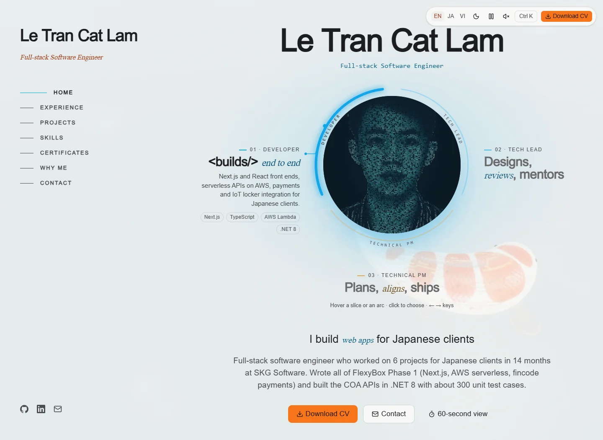

# Letcal — a koi-to-dragon portfolio

English · [日本語](README.ja.md)

A personal portfolio for **Lê Trần Cát Lâm**, presenting project evidence through three perspectives: **Developer**, **Tech Lead**, and **Technical PM**. A continuous Japanese garden follows the reader from a koi pond to a dragon's ascent.

[Website](https://letcal.is-a.dev) · [Design specification](docs/superpowers/specs/2026-10-13-portfolio-koi-redesign-design.md) · [CI and release flow](docs/ci-release.md)

> **Frontend v1** is live at [letcal.is-a.dev](https://letcal.is-a.dev). Content is stored in Supabase and edited through a private admin area at `/admin`.

## Preview

<picture>
  <source media="(prefers-color-scheme: dark)" srcset="docs/images/portfolio-dark.webp">
  
</picture>

Desktop preview with Motion off. [Dark](docs/images/portfolio-dark.webp) · [Light](docs/images/portfolio-light.webp).

## Experience

- **Three roles, one evidence base.** A circular selector changes the introduction, accents, CV selection, and ordering of relevant experience and skills.
- **Three languages.** English, Japanese, and Vietnamese pages and metadata at `/en`, `/ja`, and `/vi`.
- **Work with context.** Experience timeline, project case studies, skill evidence, certificates, and contact details.
- **One continuous scene.** Desktop WebGL combines a koi/dragon, chapter cameras, lotus pond, waterfall, lanterns, day/night lighting, and pointer interactions. Mobile, reduced-motion, and unavailable-WebGL paths use static backgrounds.
- **Reader controls.** Keyboard navigation, Motion switch, command palette, and a printable 60-second view at `/en/quick`, `/ja/quick`, and `/vi/quick`.

## Architecture

| Layer | Implementation |
| --- | --- |
| Pages and rendering | Next.js **16.4**, React **19.3**, TypeScript, App Router, Cache Components |
| Content | Supabase Postgres with row level security, Zod validation, cached server reads, seed fallback |
| Admin | Supabase Auth, proxy route guard, server actions, config-driven forms, direct-to-storage uploads |
| Localization | next-intl with build-time message precompilation |
| UI | Tailwind CSS, Radix UI, repository-owned components, vendored shadcn CSS |
| Animation | Motion, GSAP/ScrollTrigger, Lenis; shared effective motion preference |
| Scene | Three.js, React Three Fiber, Drei; device tiers, deferred chunks, static fallback |
| Verification | Vitest, Testing Library, Playwright/axe, artifact budgets, Lighthouse |
| Delivery | GitHub Actions checks; Vercel hosting through the repository integration |

Server Components read content through `src/lib/data/get-content.ts`, cached under the `content` tag. Admin saves call `updateTag('content')`, so the next visitor sees the change. Without a configured Supabase URL the site uses `src/content/seed.json`; failed or invalid Supabase responses also fall back to the seed, with a shorter cache lifetime.

Visitors read through the publishable key, and row level security only returns published rows. Writes require an email listed in `private.app_admins`, a schema the Data API does not expose. The proxy also sends anyone other than `ADMIN_EMAIL` from `/admin` to the login page. `src/lib/data/columns.ts` describes every table once: tests check it against the row mappers, and `supabase/schema.sql` is generated from it.

The scene loads separately from the page content. Mobile uses static imagery; capable desktop devices load live scenery after the page load gate. Production builds verify and use committed portraits, fallbacks, icons and the skill sprite without re-encoding them for the build machine. After editing their sources, run `npm run generate:assets`, review the generated diff and commit it. Exact dependency versions are in `package-lock.json`.

## Local setup

Use **Node.js 22.19 or newer within Node 22.x**, plus npm. Lighthouse 13.5.0 requires Node ≥22.19.

```sh
npm ci
npm run dev
```

Open [http://localhost:3000/en](http://localhost:3000/en). **No environment file, database, or service account is needed for the seed-backed frontend.** For a production build:

```sh
npm run build
npm run start
```

### Database and admin (optional)

1. Create a Supabase project and apply `supabase/migrations/` in order (SQL editor or `supabase db push`).
2. Copy [.env.example](.env.example) to `.env.local` and fill in the project URL, publishable key, secret key and `ADMIN_EMAIL`. Never commit it, and never expose `SUPABASE_SERVICE_ROLE_KEY` through a `NEXT_PUBLIC_` variable.
3. `npm run db:seed` loads `seed.json`; `npm run db:verify` reads it back with the public key and compares every section.
4. In Supabase Auth, create the admin user, then run `insert into private.app_admins (email) values ('<email>');`.
5. Sign in at `/admin/login`.

After changing `columns.ts`, run `npm run db:schema` and add a migration for the live database. The `Supabase keep-alive` workflow reads one row twice a week so a free project does not pause; it uses the `SUPABASE_URL` and `SUPABASE_PUBLISHABLE_KEY` repository variables.

The `@swc/core` override preserves an existing Windows tooling workaround. Review Windows and Linux behavior before changing it. Builds also need network access for `next/font/google` font downloads.

## Verification

The font artifact checks also require [uv](https://docs.astral.sh/uv/getting-started/installation/) and Python 3.11 or newer. The font script declares pinned, isolated FontTools/Brotli dependencies; normal development and production builds require only Node.js/npm. CI provisions uv explicitly.

Run from the repository root. Type and artifact checks follow the build because they consume generated output.

```sh
npm run lint
npm test
npm run build
npx --no-install tsc --noEmit
npm run check:bundle
npm run test:budgets
npm audit --omit=dev --audit-level=high
```

Install Chromium, then run the browser suite. On Linux, install system dependencies with `npx --no-install playwright install --with-deps chromium`.

```sh
npx --no-install playwright install chromium
npm run test:e2e -- --workers=1
```

Playwright builds and starts production on **port 3100**; outside CI it can reuse an existing server there. Confirm that a reused server matches the revision under review. Development on port 3000 stays separate. Windows uses D3D11; Linux uses SwiftShader. CI uses one worker and bounded longer waits for software rendering. Motion-specific tests explicitly exercise animated behavior.

For mobile performance, stop competing browser/test workloads and start the production build on port 3100 in one terminal:

```sh
npm run start -- -p 3100
```

In another terminal, with Chrome installed or `CHROME_PATH` pointing to a compatible executable:

```sh
npm run check:performance
```

This collects **three runs per locale** and checks independent medians. `PERF_ORIGIN` selects another production server; `PERF_TRACE=1` saves diagnostic assets for each locale's first run. Reports go to `.lighthouseci/`.

| Check | Threshold | Effect |
| --- | ---: | --- |
| Initial JavaScript | ≤200 KB gzip | blocks merge |
| Lighthouse Accessibility | ≥95 | blocks merge |
| Lighthouse SEO | ≥90 | blocks merge |
| CLS | ≤0.1 | blocks merge |
| Lighthouse Performance | ≥85 | advisory warning |
| LCP / TBT | ≤2500 ms / ≤200 ms | advisory warning |

Lab loading metrics vary between runs on shared CI machines, so they are reported on every PR but do not block it. Real-user Core Web Vitals are collected in production with Vercel Speed Insights. See the [CI and release flow](docs/ci-release.md).

## Repository map

```text
src/app/[locale]/   Localized routes, layouts, metadata, quick view
src/components/    Sections, controls, effects
src/content/       Public seed, schema, generated portrait props
src/lib/data/      Repositories, table columns, mapping, cached content access
src/app/admin/     Admin login, dashboard and editors
src/lib/admin/     Admin guard, resource config, server-side data
supabase/          Migrations and the generated current schema
src/scene/         Creature, scenery, input, device tiers
public/            Public CVs, stylized portraits, models, fallbacks
scripts/           Asset generation and release measurements
tests/             Unit, browser, script and asset checks
docs/              Design decisions and release evidence
```

## Design notes

The koi-to-dragon story connects the sections through a shared environment. Role accents, restrained text surfaces, and reversible chapter transitions keep the project evidence readable while retaining the garden's character.

- [Content surfaces and scroll stability](docs/superpowers/reports/content-surfaces-review.md)
- [Continuous day/night garden](docs/superpowers/reports/garden-day-night-review.md)
- [Obsidian night palette](docs/superpowers/reports/garden-night-palette.md)
- [Waterfall assets and provenance](docs/superpowers/reports/waterfall-environment-review.md)
- [Domain setup](docs/domain-is-a-dev.md)

## Contributions, security, and reuse

Maintained by Lê Trần Cát Lâm. See [CONTRIBUTING.md](CONTRIBUTING.md) for scoped changes and validation, [SECURITY.md](SECURITY.md) for private vulnerability reporting, and the [maintenance record](docs/repository-maintenance.md) for verified repository settings. Issues may be written in English or Japanese.

No repository-wide license is currently supplied. This documentation grants no additional reuse rights. Third-party components and assets retain their own terms: see the [vendored shadcn notice](src/app/vendor/SHADCN-LICENSE.txt), [icon notices](src/components/site/icons.tsx), and waterfall provenance above. Personal portraits, CVs, and brand assets are not offered as reusable template content.
Font assets and their SIL Open Font License notices are documented in [font provenance](src/app/fonts/README.md).
