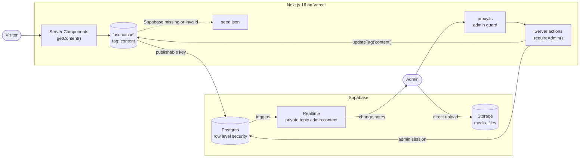
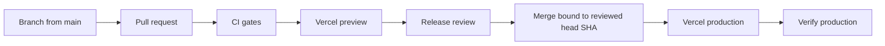

# Letcal — a koi-to-dragon portfolio

English · [日本語](README.ja.md)

A personal portfolio for **Lê Trần Cát Lâm**, presenting project evidence through three perspectives: **Developer**, **Tech Lead**, and **Technical PM**. A continuous Japanese garden follows the reader from a koi pond to a dragon's ascent.

[Website](https://letcal.is-a.dev) · [Design specification](docs/superpowers/specs/2026-10-13-portfolio-koi-redesign-design.md) · [CI and release flow](docs/ci-release.md)

> **Frontend v1** is live at [letcal.is-a.dev](https://letcal.is-a.dev). Content is stored in Supabase and edited through a private admin area at `/admin`.

## Preview

<picture>
  <source media="(prefers-color-scheme: dark)" srcset="docs/images/portfolio-dark.webp">
  
</picture>

Desktop preview with Motion off. [Dark](docs/images/portfolio-dark.webp) · [Light](docs/images/portfolio-light.webp).

## Experience

- **Three roles, one evidence base.** A circular selector changes the introduction, accents, CV selection, and ordering of relevant experience and skills.
- **Three languages.** English, Japanese, and Vietnamese pages and metadata at `/en`, `/ja`, and `/vi`.
- **Work with context.** Experience timeline, project case studies, skill evidence, certificates, and contact details.
- **One continuous scene.** Desktop WebGL combines a koi/dragon, chapter cameras, lotus pond, waterfall, lanterns, day/night lighting, and pointer interactions. Mobile, reduced-motion, and unavailable-WebGL paths use static backgrounds.
- **Reader controls.** Keyboard navigation, Motion switch, command palette, and a printable 60-second view at `/en/quick`, `/ja/quick`, and `/vi/quick`.

## Architecture

| Layer | Implementation |
| --- | --- |
| Pages and rendering | Next.js **16.4**, React **19.3**, TypeScript, App Router, Cache Components |
| Content | Supabase Postgres with row level security, Zod validation, cached server reads, seed fallback |
| Admin | Supabase Auth, proxy route guard, server actions, config-driven forms, direct-to-storage uploads |
| Localization | next-intl with build-time message precompilation |
| UI | Tailwind CSS, Radix UI, repository-owned components, vendored shadcn CSS |
| Animation | Motion, GSAP/ScrollTrigger, Lenis; shared effective motion preference |
| Scene | Three.js, React Three Fiber, Drei; device tiers, deferred chunks, static fallback |
| Verification | Vitest, Testing Library, Playwright/axe, artifact budgets, Lighthouse |
| Delivery | GitHub Actions checks; Vercel hosting through the repository integration |

The scene loads separately from the page content. Mobile uses static imagery; capable desktop devices load live scenery after the page load gate. Production builds verify and use committed portraits, fallbacks, icons and the skill sprite without re-encoding them for the build machine. After editing their sources, run `npm run generate:assets`, review the generated diff and commit it. Exact dependency versions are in `package-lock.json`.

## Architecture & engineering process

How the system is built and how a change reaches production. Each point links to the code, workflow, record or pull request that shows it.

### Runtime



- **One read path.** Server Components read content only through [`get-content.ts`](src/lib/data/get-content.ts), cached under the `content` tag. Admin saves call `updateTag('content')`, so the next visitor sees the change without a redeploy.
- **Seed fallback.** Without a Supabase URL the site uses [`seed.json`](src/content/seed.json). A failing or schema-invalid Supabase response also falls back to the seed, cached for minutes only so the site recovers on its own.
- **One content model.** One Zod schema validates the seed, database rows and admin forms. Text fields hold EN/JA/VI together; JA and VI fall back to EN. [`columns.ts`](src/lib/data/columns.ts) describes every table once: tests check it against the row mappers, and `supabase/schema.sql` is generated from it.
- **Admin data stays out of the public cache.** Preview of hidden content uses Draft Mode and a request-scoped read that re-checks the admin on every render.
- **Live admin.** Database triggers send `{ table, op, key }` notes (never row data) on a private Realtime topic only the admin can join. Other admin tabs refresh without overwriting unsaved edits.

### Security model

The database is the boundary. The proxy and server actions are defense in depth: they give clear errors and keep open forms, but a forged request still meets row level security.

| Layer | What it enforces | Where |
| --- | --- | --- |
| Proxy | `/admin/**` sends anyone except the configured admin to login | [`src/proxy.ts`](src/proxy.ts), [`guard.ts`](src/lib/admin/guard.ts) |
| Server actions | `requireAdmin()` runs before every write; `SESSION_EXPIRED` and `FORBIDDEN` are distinct | [`session.ts`](src/lib/admin/session.ts), [`actions.ts`](src/app/admin/actions.ts) |
| Postgres RLS | Visitors read published rows; writes, history, bucket listing and Realtime notes require `private.is_admin()` | [`supabase/migrations/`](supabase/migrations) |
| Private schema | The admin allowlist and history live in `private`, which the Data API does not expose | [`0002_private_admin.sql`](supabase/migrations/0002_private_admin.sql), [`config.toml`](supabase/config.toml) |
| Public cache | The anonymous `"use cache"` scope never reads cookies or admin data | [`get-content.ts`](src/lib/data/get-content.ts), [`preview-content.ts`](src/lib/data/preview-content.ts) |
| CI | Read-only default token, SHA-pinned actions, no `pull_request_target`, no repository secrets; only the Dependabot auto-merge job can write | [`.github/workflows/`](.github/workflows), [CI procedure](docs/ci-release.md) |

RLS denials are tested against a real, disposable Supabase stack in CI, never against hosted data. Hosted previews share the production database, so review there is read-only. A read-only reviewer role for signed-in preview checks is proposed in [PR #20](https://github.com/Let-cal/My_Portfolio/pull/20), which includes its security note (access matrix, guards, residual risks, revocation); it is not on `main` yet. Vulnerability reports: [SECURITY.md](SECURITY.md).

### How a change ships



1. **Design first for larger work.** A spec or plan in [docs/superpowers/](docs/superpowers) is committed before the code. For example, the [realtime spec](docs/superpowers/specs/2026-10-20-admin-realtime-design.md) is the first commit of [PR #13](https://github.com/Let-cal/My_Portfolio/pull/13).
2. **Small commits with tests.** Conventional prefixes (`feat(admin):`, `fix(db):`, `test(admin):`, `ci:`). Behaviour changes carry their tests; fixes start from a failing test where practical, and verification records note the failing-then-passing runs ([example](docs/admin-integration-verification-2026-10-24.md)). A pre-push hook runs `npm run verify:quick`; `npm run verify` mirrors the quality job.
3. **Pull request.** The [template](.github/pull_request_template.md) asks for the problem, commands actually run, visual evidence and remaining gates. Review findings and their fixes stay in the PR history.
4. **CI gates** (below). Branch protection requires an up-to-date branch, applies to administrators and blocks force pushes ([maintenance record](docs/repository-maintenance.md)).
5. **Preview and release review.** Vercel builds every PR. An owner-started review collects exact-revision evidence and evaluates it with the fail-closed [`review-release.mjs`](.github/scripts/review-release.mjs) ([runbook](docs/final-review-release.md)). Auth/RLS, CI/CD, permissions and migrations need the owner's approval of the concrete diff.
6. **Merge and verify.** A merge commit bound to the reviewed head SHA. Vercel deploys `main`; merged, deployed and verified are reported as separate states. Hosted database migrations are a separate, approved step.

Dependabot patch and minor updates merge automatically after the required checks pass ([workflow](.github/workflows/dependabot-auto-merge.yml)); major updates and Playwright, which must move with the pinned CI image, wait for a person. Representative PRs: [#12](https://github.com/Let-cal/My_Portfolio/pull/12) history and undo, [#13](https://github.com/Let-cal/My_Portfolio/pull/13) realtime, [#15](https://github.com/Let-cal/My_Portfolio/pull/15) media library, [#18](https://github.com/Let-cal/My_Portfolio/pull/18) disposable integration tests, [#19](https://github.com/Let-cal/My_Portfolio/pull/19) release gate v2.

### CI gates

| Check | Runs | Effect |
| --- | --- | --- |
| Lint, types, unit tests and budgets | Prettier, ESLint, generated files, Vitest, build, `tsc`, initial JS ≤200 KB gzip, artifact budgets | Required; any failure blocks |
| Playwright Chromium on Linux | Full Chromium suite in two duration-balanced groups; rejects missing, duplicated, skipped or flaky results | Required; blocks |
| Lighthouse mobile | Three runs per locale, medians | Required; Accessibility ≥95, SEO ≥90 and CLS ≤0.1 block; Performance ≥85, LCP and TBT warn only |
| Disposable admin Auth, CRUD and RLS | Local Supabase in Docker: migration replay, real Auth/RLS/Storage/Realtime probes, six admin browser scenarios | Fails the CI workflow; not in the required list |
| Gitleaks full history | Checksum-pinned Gitleaks over all branches and tags | Required; blocks |
| Production npm audit (high and critical) | `npm audit --omit=dev --audit-level=high` | Required; blocks |
| Read-only JavaScript and TypeScript analysis | CodeQL `security-extended`; no upload from PRs | Required; errors or severity ≥7 block, lower findings are reviewed |
| Vercel | Preview deployment for the PR | Required |

"Required" reflects branch protection on `main` as read from the GitHub API on 2026-10-25; protection is live repository state that the YAML does not set. Workflows: [ci.yml](.github/workflows/ci.yml), [security.yml](.github/workflows/security.yml), [codeql.yml](.github/workflows/codeql.yml). Lab loading metrics vary on shared runners, so they are advisory ([ADR-0005](docs/adr/0005-pragmatic-ci-gates.md)).

### Decision records

[Architecture Decision Records](docs/adr/README.md) give the context, trade-offs and evidence for each choice:

- [0001](docs/adr/0001-three-locales-one-content-model.md) Three locales with one content model
- [0002](docs/adr/0002-cached-content-loader-with-seed-fallback.md) One cached content loader with a seed fallback
- [0003](docs/adr/0003-3d-scene-never-blocks-content.md) The 3D scene never blocks content
- [0004](docs/adr/0004-rls-as-the-final-guard.md) Row level security is the final guard; the admin allowlist is private
- [0005](docs/adr/0005-pragmatic-ci-gates.md) Block on stable signals; report lab loading metrics as advisory
- [0006](docs/adr/0006-content-history-with-triggers.md) Content history through database triggers; restore is admin-only
- [0007](docs/adr/0007-private-realtime-broadcast.md) Live admin updates through a private Realtime Broadcast topic
- [0008](docs/adr/0008-media-library-on-supabase-storage.md) Media library on Supabase Storage with admin-only listing
- [0009](docs/adr/0009-draft-preview-outside-the-public-cache.md) Draft preview of hidden content stays outside the public cache
- [0010](docs/adr/0010-disposable-supabase-integration-tests.md) Disposable local Supabase integration tests in CI
- [0011](docs/adr/0011-fail-closed-release-evaluator.md) A fail-closed evaluator for preview review evidence
- [0012](docs/adr/0012-hosted-migrations-through-reviewed-sql.md) Hosted migrations through reviewed SQL; no `db push` until reconciled
- [0013](docs/adr/0013-read-only-reviewer-role.md) Read-only reviewer role (proposed, [PR #20](https://github.com/Let-cal/My_Portfolio/pull/20))

## Local setup

Use **Node.js 22.19 or newer within Node 22.x**, plus npm. Lighthouse 13.5.0 requires Node ≥22.19.

```sh
npm ci
npm run dev
```

Open [http://localhost:3000/en](http://localhost:3000/en). **No environment file, database, or service account is needed for the seed-backed frontend.** For a production build:

```sh
npm run build
npm run start
```

### Database and admin (optional)

1. Create a Supabase project and apply `supabase/migrations/` in order (SQL editor or `supabase db push`).
   The live project was migrated through reviewed SQL, so its migration history versions differ from these file names. Do not run `supabase db push` against it until that history is reconciled.
2. Copy [.env.example](.env.example) to `.env.local` and fill in the project URL, publishable key, secret key and `ADMIN_EMAIL`. Never commit it, and never expose `SUPABASE_SERVICE_ROLE_KEY` through a `NEXT_PUBLIC_` variable.
3. `npm run db:seed` loads `seed.json`; `npm run db:verify` reads it back with the public key and compares every section.
4. In Supabase Auth, create the admin user, then run `insert into private.app_admins (email) values ('<email>');`.
5. Sign in at `/admin/login`.

After changing `columns.ts`, run `npm run db:schema` and add a migration for the live database. The `Supabase keep-alive` workflow reads one row twice a week so a free project does not pause; it uses the `SUPABASE_URL` and `SUPABASE_PUBLISHABLE_KEY` repository variables.

The admin [media library](docs/admin-media-library.md) lists uploads in `media` and `files`, links them to current content (including hidden items), and lets upload fields reuse existing files. Apply its additive Storage SELECT policy before using `/admin/media`. Built-in `public/` files are outside this library. Storage deletion is permanent and does not restore through content history.

The `@swc/core` override preserves an existing Windows tooling workaround. Review Windows and Linux behavior before changing it. Builds also need network access for `next/font/google` font downloads.

## Verification

The font artifact checks also require [uv](https://docs.astral.sh/uv/getting-started/installation/) and Python 3.11 or newer. The font script declares pinned, isolated FontTools/Brotli dependencies; normal development and production builds require only Node.js/npm. CI provisions uv explicitly.

Run from the repository root. Type and artifact checks follow the build because they consume generated output.

```sh
npm run lint
npm test
npm run build
npx --no-install tsc --noEmit
npm run check:bundle
npm run test:budgets
npm audit --omit=dev --audit-level=high
```

Install Chromium, then run the browser suite. On Linux, install system dependencies with `npx --no-install playwright install --with-deps chromium`.

```sh
npx --no-install playwright install chromium
npm run test:e2e -- --workers=1
```

Playwright builds and starts production on **port 3100**; outside CI it can reuse an existing server there. Confirm that a reused server matches the revision under review. Development on port 3000 stays separate. Windows uses D3D11; Linux uses SwiftShader. CI uses one worker and bounded longer waits for software rendering. Motion-specific tests explicitly exercise animated behavior.

For mobile performance, stop competing browser/test workloads and start the production build on port 3100 in one terminal:

```sh
npm run start -- -p 3100
```

In another terminal, with Chrome installed or `CHROME_PATH` pointing to a compatible executable:

```sh
npm run check:performance
```

This collects **three runs per locale** and checks independent medians. `PERF_ORIGIN` selects another production server; `PERF_TRACE=1` saves diagnostic assets for each locale's first run. Reports go to `.lighthouseci/`.

| Check | Threshold | Effect |
| --- | ---: | --- |
| Initial JavaScript | ≤200 KB gzip | blocks merge |
| Lighthouse Accessibility | ≥95 | blocks merge |
| Lighthouse SEO | ≥90 | blocks merge |
| CLS | ≤0.1 | blocks merge |
| Lighthouse Performance | ≥85 | advisory warning |
| LCP / TBT | ≤2500 ms / ≤200 ms | advisory warning |

Lab loading metrics vary between runs on shared CI machines, so they are reported on every PR but do not block it. Real-user Core Web Vitals are collected in production with Vercel Speed Insights. See the [CI and release flow](docs/ci-release.md).

## Repository map

```text
src/app/[locale]/   Localized routes, layouts, metadata, quick view
src/components/    Sections, controls, effects
src/content/       Public seed, schema, generated portrait props
src/lib/data/      Repositories, table columns, mapping, cached content access
src/app/admin/     Admin login, dashboard and editors
src/lib/admin/     Admin guard, resource config, server-side data
supabase/          Migrations and the generated current schema
src/scene/         Creature, scenery, input, device tiers
public/            Public CVs, stylized portraits, models, fallbacks
scripts/           Asset generation and release measurements
tests/             Unit, browser, script and asset checks
docs/              Design decisions and release evidence
```

## Design notes

The koi-to-dragon story connects the sections through a shared environment. Role accents, restrained text surfaces, and reversible chapter transitions keep the project evidence readable while retaining the garden's character.

- [Content surfaces and scroll stability](docs/superpowers/reports/content-surfaces-review.md)
- [Continuous day/night garden](docs/superpowers/reports/garden-day-night-review.md)
- [Obsidian night palette](docs/superpowers/reports/garden-night-palette.md)
- [Waterfall assets and provenance](docs/superpowers/reports/waterfall-environment-review.md)
- [Domain setup](docs/domain-is-a-dev.md)

## Contributions, security, and reuse

Maintained by Lê Trần Cát Lâm. See [CONTRIBUTING.md](CONTRIBUTING.md) for scoped changes and validation, [SECURITY.md](SECURITY.md) for private vulnerability reporting, and the [maintenance record](docs/repository-maintenance.md) for verified repository settings. Issues may be written in English or Japanese.

The source code is available under the [MIT License](LICENSE). Personal content (portfolio text and data, CVs, portraits, screenshots and the LETCAL brand) is © Lê Trần Cát Lâm, all rights reserved: see [CONTENT-LICENSE.md](CONTENT-LICENSE.md). Third-party components and assets retain their own terms: see the [vendored shadcn notice](src/app/vendor/SHADCN-LICENSE.txt), [icon notices](src/components/site/icons.tsx), and waterfall provenance above.
Font assets and their SIL Open Font License notices are documented in [font provenance](src/app/fonts/README.md).
